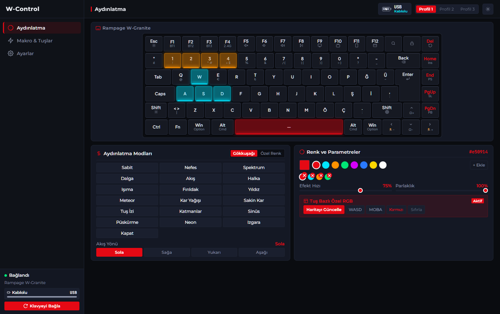
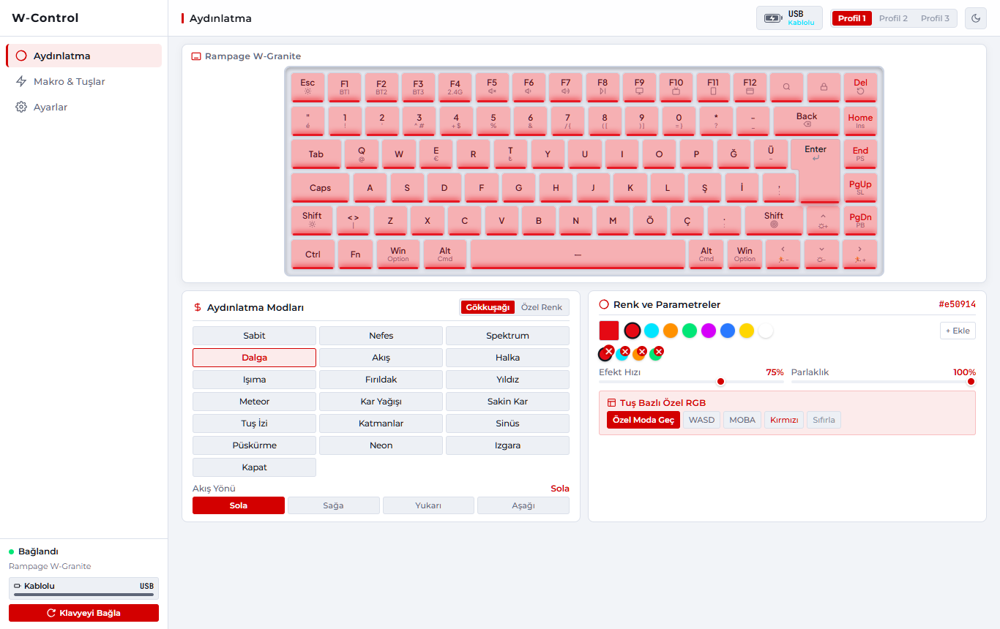
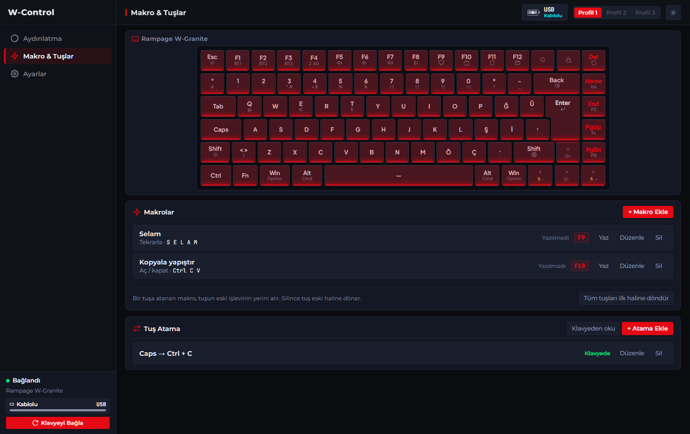
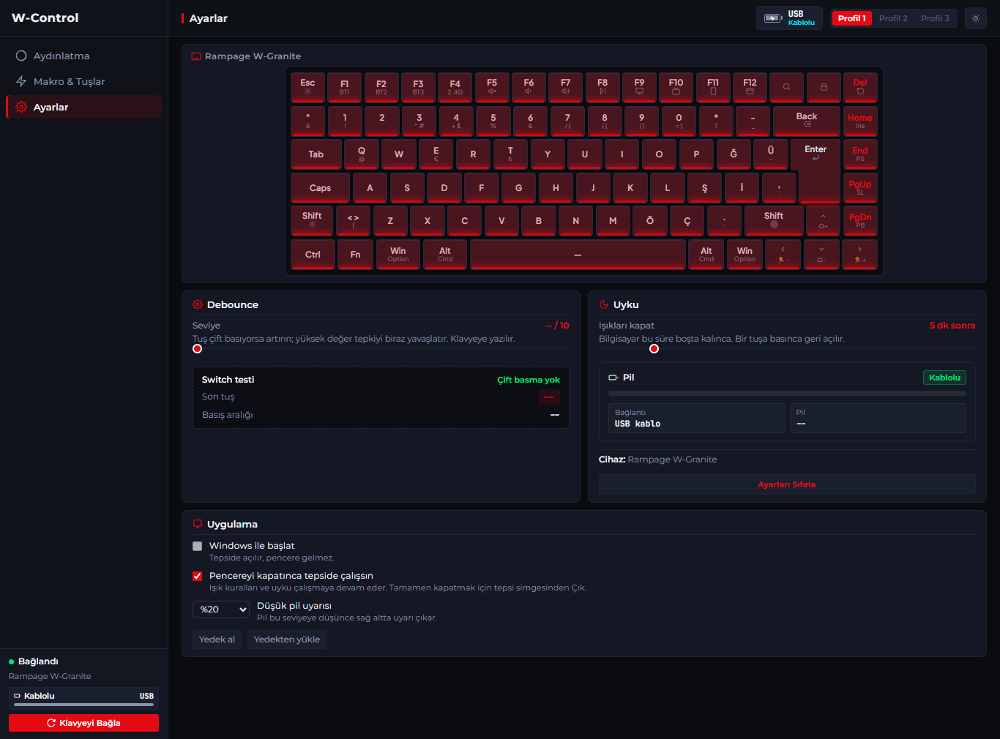

# W-Control ⚡

**English** · [Türkçe](README.tr.md)

A modern, high-performance desktop keyboard RGB lighting manager and customization suite for the **Rampage W-Granite 75% (Turkish Q)** and compatible **ROYUAN / Yichip** firmware keyboards.

Ready-made installers are on the [Releases](../../releases) page.

Built with **Tauri v2 (Rust)** for native USB HID communication and a **Vanilla JS / CSS** glassmorphic frontend.

---

## 📸 Screenshots

| Lighting (dark) | Lighting (light) |
|---|---|
|  |  |

| Macros and key assignment | Settings |
|---|---|
|  |  |

The screenshots show the interface running without a keyboard attached, so the connection shows "USB" and the debounce level is empty.

---

## 📋 Table of Contents
1. [✨ Features](#-features)
2. [Prerequisites](#-prerequisites)
3. [Quick Start & Running the App](#-quick-start--running-the-app)
   - [Development (Tauri + Vite)](#1-development-mode-recommended)
   - [Web-Only UI Preview (Vite)](#2-web-only-ui-preview-browser)
4. [Building the App for Production](#-building-the-app-for-production)
   - [Tauri Production Build (.exe / Installer)](#1-tauri-production-executable-installer)
   - [Rust Backend Only (Cargo Build / Test)](#2-rust-backend-tests--cli-build)
5. [Architecture & Communication](#-architecture--communication)
6. [Supported Hardware & Protocol](#-supported-hardware--protocol)
7. [Troubleshooting & Linker Setup](#-troubleshooting--windows-c-linker-setup)

---

## ✨ Features

- 🌈 **19 hardware lighting modes** with speed, brightness, direction and color.
- 🎨 **Per-key RGB**: click keys to color them; clicking a key with the same color again turns its light off.
- 🗂 **Lighting profiles**: three profiles (lighting settings + per-key colors) kept in the app and sent to the keyboard on switch.
- ⌨ **On-board macros**: record key sequences with timing and store them in the keyboard's memory, so they run with the app closed.
- 🔁 **Key remapping**: make a key press another key or a combination of up to three keys, stored on the keyboard.
- 🎚 **Debounce level** written to the keyboard, plus firmware version read-out.
- 📡 **Cable, 2.4G dongle and Bluetooth**: the dongle needs a relay handshake and Bluetooth uses its own report framing; the app handles both. The keyboard must be awake.
- 🔋 **Battery**: level over 2.4G and Bluetooth (the cable reports none), a low battery pop-up at a level you choose, and the tray icon tooltip shows connection and battery.
- 🔄 **Hardware sync**: polling picks up changes made on the keyboard (`Fn` shortcuts) and mirrors them in the UI.
- 🖥 **Tray, start with Windows, single instance**; closing the window can keep the app in the tray.
- 💾 **Backup**: export and import profiles, macros, key assignments and settings as one JSON file.

Not supported by this keyboard's firmware (the vendor driver stubs them out too): sleep timer, polling-rate change and side-light settings. The "Uyku" setting is an app feature: it turns the lights off when the PC is idle while the app is running.

---

## 🔒 Verifying the download

The installers are not code-signed, so Windows SmartScreen and a few antivirus engines may warn about them. On VirusTotal, 4 of 70 engines flagged `W-Control_1.0.0_x64-setup.exe` with generic machine-learning detections, which is common for new unsigned software. You can check that your download is the published file by comparing its SHA-256 (PowerShell: `Get-FileHash .W-Control_1.0.0_x64-setup.exe`) with the value on the [release page](../../releases), or skip the installer and build the app from source as described below.

---

## 🛠 Prerequisites

Ensure you have the following installed on Windows:

| Requirement | Recommended Version | Download / Installation |
|---|---|---|
| **Node.js** | `v20+` or `v22+` | [nodejs.org](https://nodejs.org) |
| **Rust Toolchain** | `1.77+` | [rustup.rs](https://rustup.rs) (`rustup default stable-x86_64-pc-windows-msvc`) |
| **Visual Studio / C++ Tools** | 2022+ Community or Build Tools | Install with **"Desktop development with C++"** workload |
| **Windows 10/11 SDK** | `10.0.18362+` | Included in VS C++ workload (provides `kernel32.lib`) |

---

## 🚀 Quick Start & Running the App

### First-Time Setup
Clone and install JavaScript dependencies:
```powershell
git clone https://github.com/BilalK61/rampage-w-granite-control.git
cd rampage-w-granite-control
npm install
```

---

### 1. Development Mode (Tauri + Vite) — *Recommended*
Spawns the Vite frontend dev server and attaches the native Rust Tauri window with live-reload and active USB HID drivers:

```powershell
# Using npm script:
npm run tauri dev

# Or directly with npx:
npx tauri dev
```

---

### 2. Web-Only UI Preview (Browser)
To inspect and test UI animations or layouts in a standard web browser (uses simulated HID fallback):
```powershell
npm run dev
```
Open [http://localhost:5173](http://localhost:5173) in Chrome or Edge.

---

## 📦 Building the App for Production

### 1. Tauri Production Executable / Installer
Builds the optimized frontend bundle and compiles the release binary into a standalone Windows installer (`.msi` / `.exe`):

```powershell
# Using npm:
npm run tauri build

# Or directly via npx:
npx tauri build
```

**Output location:**
```
src-tauri/target/release/aether-rgb.exe
src-tauri/target/release/bundle/nsis/W-Control_1.0.0_x64-setup.exe
src-tauri/target/release/bundle/msi/W-Control_1.0.0_x64_en-US.msi
```

---

### 2. Rust Backend Tests & CLI Build
To compile and test only the Rust engine without bundling the UI:

```powershell
cd src-tauri

# Run the unit tests (protocol checksums, byte encoders, math conversions):
cargo test --lib

# Build debug binary:
cargo build

# Build optimized release binary:
cargo build --release
```

---

## 🏗 Architecture & Communication

```
┌────────────────────────────────────────────────────────────┐
│                    Tauri v2 Host (Rust)                    │
│                                                            │
│  ┌──────────────────────┐   invoke('send_native_hid_rgb')  │
│  │ Commands Layer       │◄────────────────────────────┐   │
│  │ (commands/*.rs)      │   listen('hardware-rgb-sync')   │
│  │ rgb, macros, remap,  │────────────────────────────►│   │
│  │ settings, app        │                             │   │
│  └──────────┬───────────┘                             │   │
│             │                                         │   │
│  ┌──────────▼───────────┐  ┌──────────────────────────┴┐  │
│  │ HID Protocol Engine  │  │ WebView Renderer (Vite)   │  │
│  │ - Checksum builder   │  │ - src/main.js             │  │
│  │ - Poller task        │  │ - src/rgbEngine.js        │  │
│  │ - hidapi device I/O  │  │ - src/hidService.js       │  │
│  └──────────┬───────────┘  │ - src/layouts.js          │  │
│             │              └───────────────────────────┘  │
│             ▼                                             │
│      USB HID Subsystem (OS driver)                        │
└─────────────┬──────────────────────────────────────────────┘
              │
              ▼
    Rampage W-Granite (ROYUAN VID:0x3151, PID 0x4015 cable / 0x4011 dongle / 0x4013 Bluetooth)
```

---

## ⌨ Supported Hardware & Protocol

| Device | VID | PID | Interface | Usage Page |
|---|---|---|---|---|
| Rampage W-Granite 75% (USB cable) | `0x3151` | `0x4015` | `2` | `0xFFFF` |
| Rampage W-Granite 75% (2.4G dongle) | `0x3151` | `0x4011` | `2` | `0xFFFF` |
| Rampage W-Granite 75% (Bluetooth) | `0x3151` | `0x4013` | - | `0xFF55` |

### Packet Specification (65 bytes, Report ID `0` at byte 0)
Commands are feature reports. Most use a checksum `0xFF - sum(bytes[1..=7])` at byte 8 (LED parameters cover bytes 1..=8, checksum at byte 9).

| Opcode | Purpose |
|---|---|
| `0x07` / `0x87` | Set / get lighting mode, speed, brightness, color |
| `0x0C` | Per-key picture upload (7 pages, then activate mode 13) |
| `0x09` / `0x89` | Set (9 pages) / get (8 pages) key matrix: 4 bytes per key |
| `0x0B` / `0x8B` | Set / get on-board macro (5 / 4 pages) |
| `0x11` / `0x91` | Set / get debounce level (1 to 10) |
| `0x80`, `0x85` | Firmware version, current profile |

Key matrix entries: stock key `[0, 0, hid, 0]`, remap `[0, k1, k2, k3]`, macro `[9, mode, macro index, 0]`. Macro data is `[repeat lo, hi]` followed by `[hid, delay | down<<7]` records (a 4-byte form carries delays over 127 ms).

### 2.4G dongle relay
The dongle does not forward commands by itself. To send: poll `0xF7` until it reports "can send", select the keyboard with `0xF6 0x0A`, then send the command. To read: poll `0xF7` until "can read", send `0xFC`, then read the feature report. Replies can be stale, so anything that gets written back is read twice and compared first.

### Bluetooth
Over Bluetooth the keyboard exposes a vendor collection (usage page `0xFF55`) instead of a feature-report interface. A command goes out as output report `6` carrying `0x55` followed by the usual packet; the reply comes back as input report `6` with the same prefix (key matrix and macro pages arrive as raw data without an opcode echo). The battery level is asked with report `0x77` and answered as `[6, 0x77, level]`.

### Safety of key assignments
The firmware has no single-key write, so each assignment rewrites the whole key matrix. The app checks that the matrix read is complete, saves the original matrix to `%APPDATA%aether-rgbkeymap-backup-p0.bin` before the first change, and reads every write back. "Tüm tuşları ilk haline döndür" writes the backup back.

The protocol was reverse-engineered from the vendor's public web driver and checked against the keyboard.

---

## 🔧 Troubleshooting (Windows C++ Linker Setup)

If `cargo build` throws `error: linker link.exe not found` or `LNK1181: cannot open input file 'kernel32.lib'`:

1. **Option A (Automatic)**: Open the project inside **Developer Command Prompt for VS 2022** or **x64 Native Tools Command Prompt**.
2. **Option B (Project Config)**: Ensure `src-tauri/.cargo/config.toml` points to your installed Visual Studio & Windows SDK paths:
   ```toml
   [target.x86_64-pc-windows-msvc]
   linker = "C:\\Program Files\\Microsoft Visual Studio\\2022\\Community\\VC\\Tools\\MSVC\\<version>\\bin\\HostX64\\x64\\link.exe"
   rustflags = [
       "-L", "C:\\Program Files (x86)\\Windows Kits\\10\\Lib\\<sdk-version>\\um\\x64",
       "-L", "C:\\Program Files (x86)\\Windows Kits\\10\\Lib\\<sdk-version>\\ucrt\\x64",
   ]
   ```

---

## 📜 License
Released under the [MIT License](LICENSE).

This is an independent project and is not affiliated with Rampage, Segment or the keyboard's firmware vendor. Product names and logos belong to their respective owners. Use it at your own risk: the app writes to the keyboard's memory (key matrix, macros, lighting), and although it keeps a backup of the original key matrix, a firmware or hardware problem cannot be ruled out. The brand logos used by the author's own build are not included in this repository; without them the sidebar shows a plain "W-Control" title.
